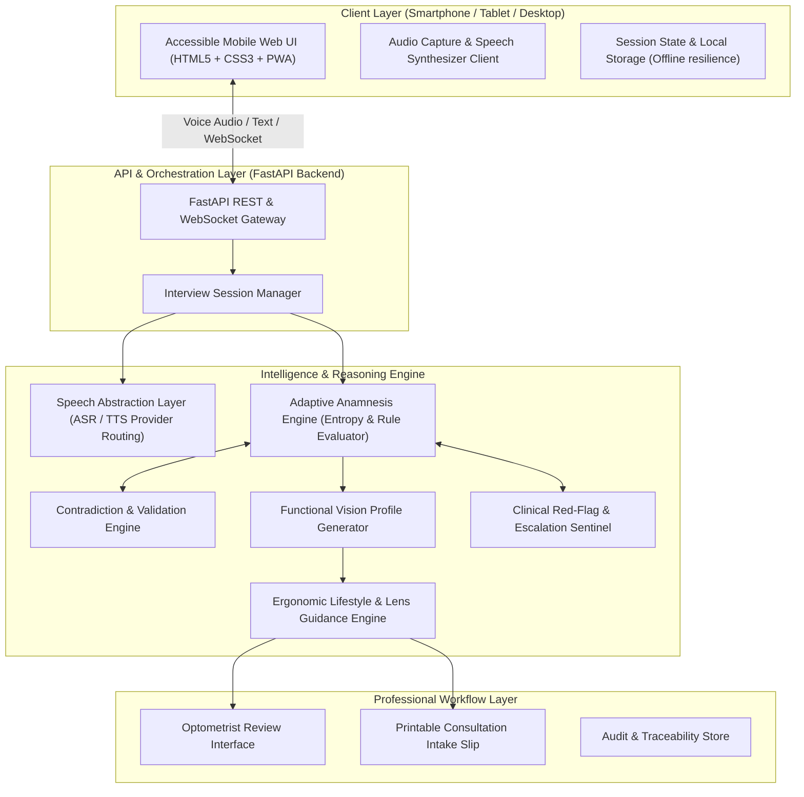

# Nayanee — System Architecture & Component Design

**Status:** Completed & Validated  

---

## 1. High-Level Architecture Diagram

---

## 2. Core Subsystems

1. **Multilingual Speech Abstraction Subsystem:** 4-tier speech cascade (Cloud Indic $\to$ Web Speech API $\to$ Acoustic Earcon Synthesizer $\to$ Visual Text Chips).
2. **Adaptive Anamnesis Subsystem:** Domain uncertainty tracking across 6 functional dimensions with dynamic entropy reduction.
3. **Contradiction & Red-Flag Sentinels:** Evaluates bidirectional consistency matrix and enforces immediate emergency halting upon acute ocular symptoms.
4. **Clinical Export & Decision Support:** Generates plain text EMR/EHR briefings and printable physical consultation intake slips.
